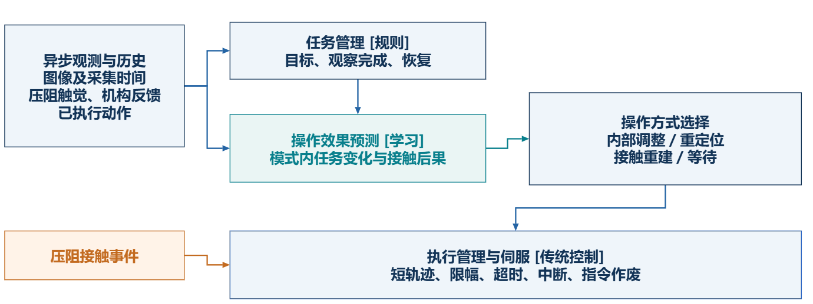

<div align="center">

<h1>Robotarm Magnetic Lab</h1>

<p><strong>磁控操作 · 多模态反馈 · 技能选择</strong></p>

<p>
<a href="docs/PROJECT.md">研究方向</a> ·
<a href="docs/IMPLEMENTED.md">已有实现</a> ·
<a href="docs/NEXT.md">开发计划</a> ·
<a href="docs/ENTRYPOINTS.md">使用入口</a>
</p>

</div>

## 项目介绍

研究如何利用图像、接触信号、机构状态与动作历史，预测短时操作效果，并在**内部调整、局部重定位、接触重建与等待**之间选择。学习模块提供效果估计，规则与传统控制负责操作选择、轨迹执行和安全管理。



<p align="center"><sub>研究框架草案：多模态观测 → 操作效果预测 → 方式选择 → 执行与反馈</sub></p>

完整方向与设计待决项见 [项目说明](docs/PROJECT.md)。

## 已有实现

| 能力 | 当前内容 | 代码入口 |
| :--- | :--- | :--- |
| **仿真场景** | 机械臂、三轴外磁体、动态胶囊与胃部场景 | [Isaac 扩展](source/robotarm_magnetic_lab) |
| **磁控执行** | 相对指令、轨迹编译、磁力矩计算与安全检查 | [磁控演示](scripts/stomach_migration/validate_new_stomach_magnetic.py) |
| **视觉与几何** | 相机同步、覆盖计算、坐标处理与状态记录 | [运行模块](source/robotarm_magnetic_lab/robotarm_magnetic_lab/runtime) |
| **工程验证** | 行为回归、配置检查与工件记录 | [测试目录](tests) |

这些模块作为后续开发基础；多模态编码、操作效果预测与统一技能选择正在设计，详细边界见 [已有实现](docs/IMPLEMENTED.md)。

## 下一阶段任务

| 阶段 | 工作重点 | 交付内容 |
| :--- | :--- | :--- |
| **数据采集** | 自有胃部仿真：病灶特征与胃壁距离，每项约300—500张图像 | 图像、标签、采集脚本与数据划分 |
| **Linear Probe评测** | 冻结RADIOv2.5、DINOv2、SigLIP2，分别训练线性分类与回归头 | 六组结果、精度与计算成本对比、选型建议 |

病灶分类报告**Accuracy / Macro-F1**，距离回归报告**MAE / RMSE**，同时记录特征提取耗时与显存。完整 [实验方案](docs/design/2026-10-25-gastric-vision-linear-probe.md) 与阶段交付维护在 [开发计划](docs/NEXT.md)。

## 基础入口

在仓库根目录运行文档检查和上下文工具，仅依赖 Python 标准库与 Git。

```bash
python scripts/research_workflow.py check
python scripts/research_workflow.py context
```

| 需要了解 | 对应文档 |
| :--- | :--- |
| 环境准备与仿真启动 | [基础入口](docs/ENTRYPOINTS.md) |
| 项目结构与能力边界 | [已有实现](docs/IMPLEMENTED.md) |
| 团队协作与 AI 工作约定 | [协作说明](AGENTS.md) |
