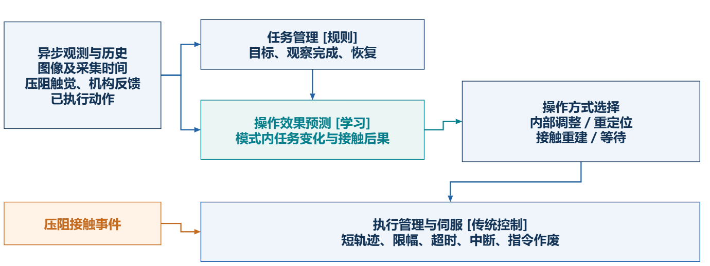
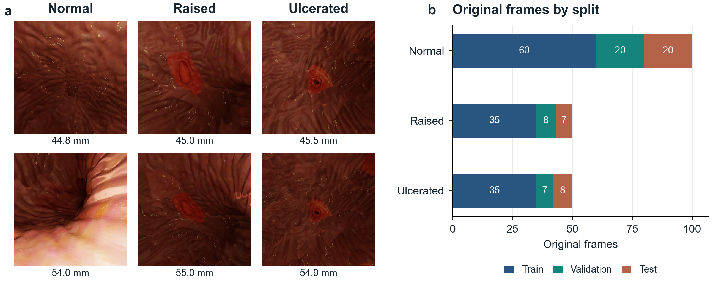

<div align="center">

<h1>Robotarm Magnetic Lab</h1>

<p><strong>磁控操作 · 多模态反馈 · 技能选择</strong></p>

<p>
<a href="docs/PROJECT.md">研究方向</a> ·
<a href="docs/IMPLEMENTED.md">已有实现</a> ·
<a href="docs/NEXT.md">开发计划</a> ·
<a href="docs/ENTRYPOINTS.md">使用入口</a>
</p>

</div>

## 项目介绍

研究如何利用图像、接触信号、机构状态与动作历史，预测短时操作效果，并在**内部调整、局部重定位、接触重建与等待**之间选择。学习模块提供效果估计，规则与传统控制负责操作选择、轨迹执行和安全管理。



<p align="center"><sub>研究框架草案：多模态观测 → 操作效果预测 → 方式选择 → 执行与反馈</sub></p>

完整方向与设计待决项见 [项目说明](docs/PROJECT.md)。

## 已有实现

| 能力 | 当前内容 | 代码入口 |
| :--- | :--- | :--- |
| **仿真场景** | 机械臂、三轴外磁体、动态胶囊与胃部场景 | [Isaac 扩展](source/robotarm_magnetic_lab) |
| **磁控执行** | 相对指令、轨迹编译、磁力矩计算与安全检查 | [磁控演示](scripts/stomach_migration/validate_new_stomach_magnetic.py) |
| **视觉与几何** | 相机同步、覆盖计算、坐标处理与状态记录 | [运行模块](source/robotarm_magnetic_lab/robotarm_magnetic_lab/runtime) |
| **工程验证** | 行为回归、配置检查与工件记录 | [测试目录](tests) |

这些模块作为后续开发基础；多模态编码、操作效果预测与统一技能选择正在设计，详细边界见 [已有实现](docs/IMPLEMENTED.md)。

## 胃部视觉编码器线性探测

使用自有胃部仿真图像完成两项冻结特征实验。新版病灶分类包含 **200 张原图**，按采集组和局部视角划分，35 张测试原图全部与采集标签一致，Macro-F1 为 1.000。胃壁距离在分箱限额筛选后保留 **312 张原图**，64 张测试原图的 MAE 为 4.48 mm，RMSE 为 5.98 mm。



**评估范围。** 肿起和溃烂各只有一个采集来源，分类结果属于同批次留出，类别语义仍待复核。距离回归按仿真采集组留出，部分场景跨集合。[实验报告、完整图表、划分清单与训练工件](experiments/dinov3-gastric-20261120/README.md) · [数据发布](https://github.com/xy211699-arch/robotarm-magnetic-lab/releases/tag/gastric-candidates-20261119-v1) · [开发计划](docs/NEXT.md)

**三编码器对比。** RADIOv2.5-B 与 SigLIP2-B 已在同一数据划分上完成验证与测试。分类结果三者同为 35/35。距离测试的最低 MAE 为 DINOv3 的 4.48 mm，最低 RMSE 为 RADIOv2.5-B 的 5.36 mm。[完整对比与图表](experiments/gastric-encoder-comparison-20261123/README.md)

## 基础入口

在仓库根目录运行文档检查和上下文工具，仅依赖 Python 标准库与 Git。

```bash
python scripts/research_workflow.py check
python scripts/research_workflow.py context
```

| 需要了解 | 对应文档 |
| :--- | :--- |
| 环境准备与仿真启动 | [基础入口](docs/ENTRYPOINTS.md) |
| 项目结构与能力边界 | [已有实现](docs/IMPLEMENTED.md) |
| 团队协作与 AI 工作约定 | [协作说明](AGENTS.md) |
