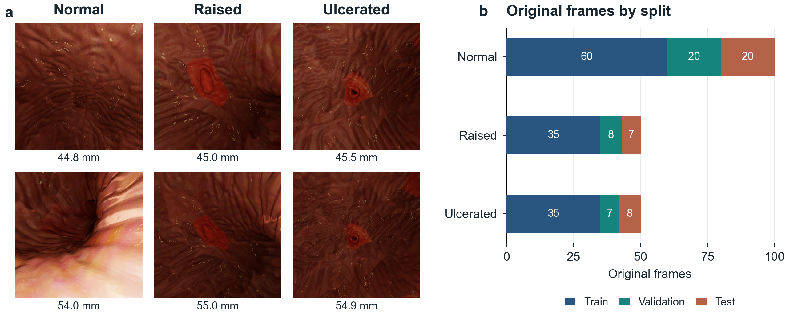
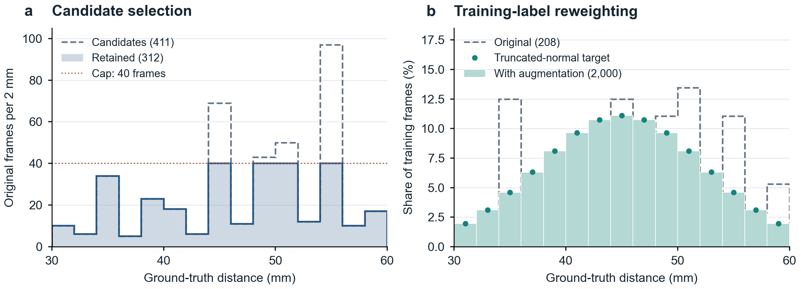
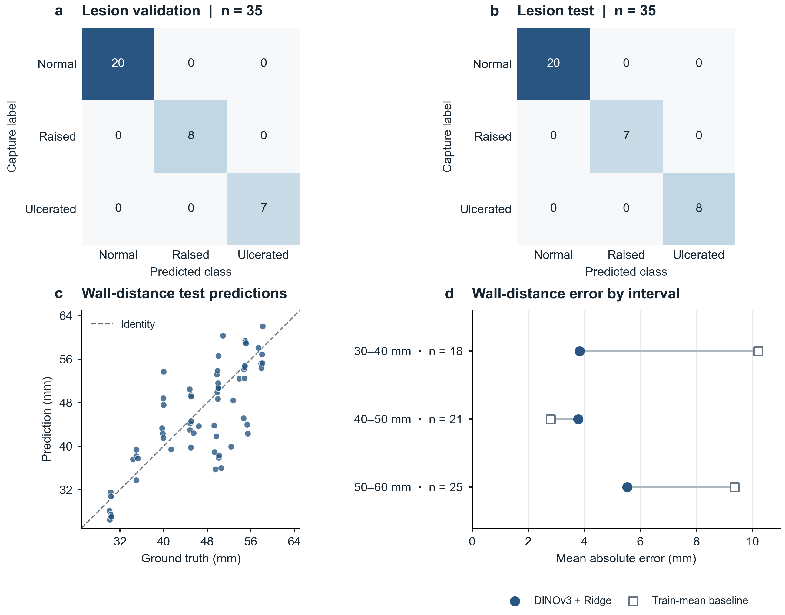

# DINOv3 胃部仿真视觉线性探测

冻结 DINOv3 ViT-B/16，在自有胃部仿真数据上分别训练三分类头和距离回归头。病灶分类的同批次留出测试为 **35/35，Macro-F1 1.000**。胃壁距离的 64 张留出原图上，**MAE 4.48 mm、RMSE 5.98 mm**。下文记录使用的数据、模型选择方法、误差及适用范围。

## 病灶分类数据

新版候选包含正常胃壁 100 张、肿起 50 张、溃烂 50 张，共 200 张原图。正常胃壁以整采集组为单位划分，两类病灶按各自采集组内记录的局部相机旋转角度划分为 30° 视角块。相同散列、近似图像和相近相机位姿按审核规则约束在相同集合。实际训练、验证、测试分别保留 130、35、35 张原图。光照与旋转增广仅用于训练，每张训练原图生成九张变体，训练实际用图为 1,300 张。



**图 1　采集样例与原图划分。** a，每个类别展示约 45 mm 和 55 mm 的两张相机原图。显示时等比例缩放并统一排版，未裁切或调整曝光和对比度。标注的毫米数为记录的相机到胃壁轴向距离。原图身份和散列可逐张核对。b，各类别的原始图像样本数。图中的样本数按图像帧计，不代表独立病灶数。[图源数据](lesion/figure-samples.csv) · [划分清单](lesion/split-manifest.csv) · [划分审计](lesion/dataset-audit.json) · [PDF](figures/lesion-data.pdf) · [SVG](figures/lesion-data.svg)

## 胃壁距离数据

距离定义为从相机光心沿局部 −Z 光轴到首次可见胃壁交点的距离，单位为毫米。411 张候选图在 30–60 mm 内按 2 mm 分箱，每箱最多保留 40 张，得到 312 张原图。原图按关联采集组划分，训练、验证、测试为 208、40、64 张，对应 7、2、2 个采集组。部分场景标识跨集合。训练增广后有 2,000 张，验证和测试均保留原图。训练图的距离标签保持原值，通过改变各距离箱的增广数量来匹配截断正态的目标箱计数。



**图 2　距离样本筛选与训练分布。** a，截断前后各 2 mm 区间的原图计数。分箱左闭右开，最后一箱含 60 mm。b，训练划分内的分箱比例，圆点为均值参数 45 mm、标准差参数 7.5 mm、区间 30–60 mm 的截断正态目标概率。增广后的整数配额与目标分箱计数一致。增广样本共享原图的距离，不构成新的独立测量。[截断计数](wall-distance/cap-bins.csv) · [增广配额](wall-distance/augmentation-bins.csv) · [原图划分](wall-distance/original-split.csv) · [排除清单](wall-distance/excluded-by-cap.csv) · [训练划分](wall-distance/split-manifest.csv) · [PDF](figures/wall-distance-data.pdf) · [SVG](figures/wall-distance-data.svg)

## 训练与评估

编码器使用官方 LVD-1689M 预训练权重，冻结主干，输入为 256 × 256 RGB 图像，经双线性抗锯齿缩放和 ImageNet 归一化。候选使用第 11、12 个 Transformer 块的归一化 CLS 特征，特征提取用 BF16，缓存用 FP32。两个任务各比较两层与五个正则化强度的组合，标准化和线性头仅在训练样本上拟合。分类优先最大化验证 Macro-F1，回归优先最小化验证 MAE。冻结选定方案和分类头或回归头后才提取测试特征。两项实验均记录单次数据划分与运行，未做跨种子或外部重复。

**病灶分类。** 验证选定第 12 层加 L2 逻辑回归，正则化参数 C = 0.01。验证与测试的 Accuracy 均为 100%，Macro-F1 均为 1.000。测试集 20 张正常、7 张肿起、8 张溃烂全部与采集标签一致。测试按视角留出，肿起和溃烂各自只有一个采集来源，采集标签的语义仍待复核。这些结果适用于同批次留出，独立病灶和真实场景的表现仍待验证。[训练协议](lesion/protocol.json) · [验证搜索](lesion/validation-search.csv) · [选定参数](lesion/frozen-selection.json) · [测试指标](lesion/test-metrics.json) · [逐图预测](lesion/test-predictions.csv) · [分类头](lesion/frozen-linear-head.joblib)

**胃壁距离。** 验证选定第 12 层加 Ridge 回归，α = 1。验证 MAE/RMSE 为 3.48/4.54 mm。测试 MAE/RMSE 为 4.48/5.98 mm，训练均值基线为 7.44/8.68 mm。40–50 mm 区间中，模型 MAE 为 3.78 mm，基线为 2.80 mm。50–60 mm 区间的平均有符号误差为 −2.82 mm。距离真值已与采集几何投影和已保存的渲染中心深度核对，场景首交点的独立回放仍待验证。[训练协议](wall-distance/protocol.json) · [验证搜索](wall-distance/validation-search.csv) · [选定参数](wall-distance/frozen-selection.json) · [测试指标](wall-distance/test-metrics.json) · [逐图预测](wall-distance/test-predictions.csv) · [回归头](wall-distance/frozen-linear-head.joblib)



**图 3　验证与留出测试结果。** a、b，病灶分类的验证与测试混淆矩阵，单元格为原始帧数，使用同一颜色范围。c，全部 64 张回归测试原图的真实与预测距离，虚线为预测等于真值。d，三个距离区间的模型 MAE 与训练均值基线 MAE，连线表示同一组帧上的两种方法比较。MAE 和 RMSE 分别为绝对误差的均值与平方误差均值的平方根。未绘制区间估计，所有面板均来自一次固定划分。[PDF](figures/held-out-results.pdf) · [SVG](figures/held-out-results.svg)

## 记录与复核

NVIDIA L40 上两项任务的训练和验证特征提取分别用时约 32.66 秒与 53.14 秒，测试阶段分别用时 0.99 秒和 1.60 秒。计时含读图、散列校验、解码、预处理和编码，预热及落盘时间单独处理。GPU 峰值已分配显存约 590 MiB，峰值预留显存约 812 MiB。选定分类头与回归头的 CPU 拟合用时约 0.03 秒和 0.27 秒。[分类提取记录](lesion/train-val-extraction.json) · [回归提取记录](wall-distance/train-val-extraction.json)

原图和采集记录位于 [数据发布](https://github.com/xy211699-arch/robotarm-magnetic-lab/releases/tag/gastric-candidates-20261119-v1)。按编号合并归档两部分并核对 [发布校验值](source-release.json)。原图清单保留 `source_image`、`source_metadata` 与 SHA-256，源路径相对归档中的 `capture_source/`。两个训练清单记录每一张入模图像的集合、母图、散列和增广参数。发布的模型是两个拟合后的线性头及标准化参数。使用时需要与训练相同的 DINOv3 编码器和预处理配置，官方权重通过 [DINOv3 官方项目](https://github.com/facebookresearch/dinov3) 获取并按协议核对散列。

可用 [归档恢复脚本](scripts/restore_originals.py) 将已解包的发布目录恢复为两套原图输入，再用 [离线增广脚本](scripts/augment_gastric_offline.py) 生成训练图片。分类增广脚本生成 2,000 张候选，实际只按分类划分清单使用其中 1,300 张训练图片和 70 张留出原图。下面的命令在本目录运行。绘图需要 Python、Matplotlib、NumPy 和 Pillow，校验不需要 GPU。

```bash
python scripts/verify_results.py
python scripts/restore_originals.py /path/to/unpacked-release /path/to/restored
python scripts/augment_gastric_offline.py --classification-root /path/to/restored/lesion \
    --regression-root /path/to/restored/wall-distance --output /path/to/augmented
python scripts/render_figures.py --image-root /path/to/restored
```

运行时的绝对路径、软件版本与权重散列留在训练协议中供审计。[文件哈希](SHA256SUMS)
