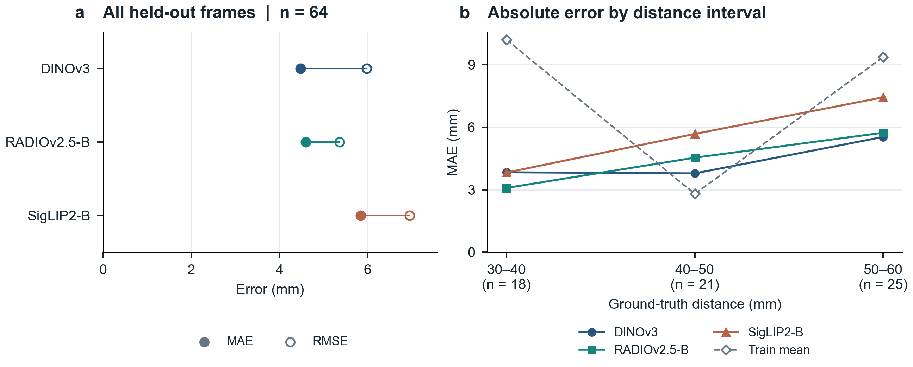

# 胃部仿真视觉编码器对比

2026 年 11 月 23 日在 NVIDIA L40 上完成 RADIOv2.5-B 与 SigLIP2-B 的病灶分类和胃壁距离线性探测。对比纳入此前发布的 DINOv3 ViT-B/16，三种编码器使用同一份病灶分类清单和同一份距离回归清单。病灶测试三种模型均为 35/35，Macro-F1 均为 1.000。距离测试的最低 MAE 来自 DINOv3，最低 RMSE 来自 RADIOv2.5-B。[六组验证、测试与开销汇总](summary.csv)

## 数据划分与训练

病灶分类使用新版 200 张原图。增广只进入训练，实际训练、验证和测试的样本数为 1,300、35、35。正常胃壁按采集组划分，肿起与溃烂按各自来源中的局部视角分块留出，两类各只有一个病灶采集来源。测试原图为正常 20 张、肿起 7 张、溃烂 8 张。距离回归使用分箱限额保留的 312 张原图，按关联采集组划分。训练增广后的三组样本数为 2,000、40、64，验证和测试使用原图。距离定义为相机光心沿局部负 Z 光轴至首次可见胃壁交点的距离。完整划分、原图来源和 SHA-256 已随 DINOv3 发布。[病灶划分](../dinov3-gastric-20261120/lesion/split-manifest.csv) · [距离划分](../dinov3-gastric-20261120/wall-distance/split-manifest.csv)

三种模型均冻结编码器，使用 256 × 256 RGB 输入和各自的预处理。新模型选用与 DINOv3 相近的基础版和 16 像素补丁。RADIOv2.5-B 使用 NVIDIA 的输入归一化和主干输出。SigLIP2-B 使用 Google 的固定分辨率权重和处理器，仅调用视觉塔。新模型各比较最终全局特征与最终空间特征均值，DINOv3 比较第 11、12 块的归一化 CLS。每种特征均比较与 DINOv3 相同的五档正则化。训练集拟合标准化和 L2 逻辑回归或 Ridge。分类按验证 Macro-F1 选参，回归按验证 MAE 选参，并在测试特征提取前保存所选配置和线性头的散列。两款新增模型在两项任务中均选定全局特征。[NVIDIA 官方实现](https://github.com/NVlabs/RADIO/blob/4ffaf15d0ff48197c194e306772bdb5fb92db230/README.md) · [Google 官方模型卡](https://huggingface.co/google/siglip2-base-patch16-256) · [执行顺序](execution-order.txt)

## 测试结果

**病灶分类。** 三种模型在 35 张验证原图和 35 张测试原图上均达到 100% 准确率和 1.000 Macro-F1。这个划分上的分类表现已达到上限，结果无法区分三种模型在独立病灶上的能力。两类病灶共享各自的采集来源，标签语义仍待复核。[测试混淆计数](lesion-confusion.csv)

**胃壁距离。** 在同一组 64 张测试原图上，DINOv3 的 MAE/RMSE 为 4.48/5.98 mm，RADIOv2.5-B 为 4.59/5.36 mm，SigLIP2-B 为 5.84/6.95 mm，训练均值基线为 7.44/8.68 mm。RADIOv2.5-B 在 30–40 mm 段的 MAE 最低，为 3.08 mm。40–50 mm 段三种模型的 MAE 均高于训练均值基线。50–60 mm 段三者均出现负偏差，分别为 −2.82、−5.73 和 −6.84 mm。当前数据有部分场景跨集合，所有结果均为固定划分的单次测量，尚无跨场景或重复采集估计。[分段误差与基线](wall-distance-intervals.csv)



**图 1　胃壁距离留出评估。** a，64 张测试原图上的绝对误差均值和均方根误差。b，按真实距离区间计算 MAE。每个区间使用同一批帧进行比较，连线用于识别模型，区间间不做插值。灰色菱形虚线为训练均值基线。图中的样本数按帧计，图表未估计独立采集批次间的波动。[PDF](wall-distance-comparison.pdf) · [SVG](wall-distance-comparison.svg)

## 开销与复核

特征提取在 L40 上采用 BF16、批大小 32、两批预热。计时包含读图、散列核对、解码、预处理和编码，峰值显存含已加载视觉模型。测试提取的病灶分类／胃壁距离时间，DINOv3 为 0.99／1.60 秒，RADIOv2.5-B 为 0.89／1.66 秒，SigLIP2-B 为 1.00／1.81 秒。对应的测试峰值分配显存约为 590、631、579 MiB。DINOv3 的开销来自前次运行，这些秒数保留实测值，单次运行及不同模型的预处理开销限制了速度对比。[完整开销与验证指标](summary.csv)

四个新增实验在开发机上重新加载冻结线性头，用缓存的测试特征复算了逐图预测。汇总脚本另外根据公布的逐图预测和固定划分核对指标、样本身份、类别与距离标签、模型和协议散列。完整的预训练主干通过官方来源取得。仓库提供线性头、协议、搜索记录、逐图预测和复算脚本，预训练权重、特征缓存与原始采集数据沿用各自的保存位置。[冻结头重放记录](frozen-head-check.txt) · [RADIOv2.5-B 两项结果](runs/radio-v2.5-b) · [SigLIP2-B 两项结果](runs/siglip2-base) · [DINOv3 原始实验](../dinov3-gastric-20261120)

在本目录可用 Python 3.11 及以上版本复算统计。评估脚本的 `audit` 阶段核对已有清单，`smoke` 阶段仅使用训练原图验证输出，`validate` 与 `test` 应分开运行。环境需要与各次 `protocol.json` 一致的依赖，预训练权重、模型配置和图像按脚本中的目录约定放置。测试阶段会检查验证协议、特征缓存及线性头的散列。

```bash
python scripts/summarize.py
python scripts/render_comparison.py
```

训练与测试使用的确切模型版本、权重散列、处理器配置和选参规则见各任务的 `protocol.json`。[评估脚本](scripts/encoder_probe.py) · [已发布文件校验值](SHA256SUMS)
